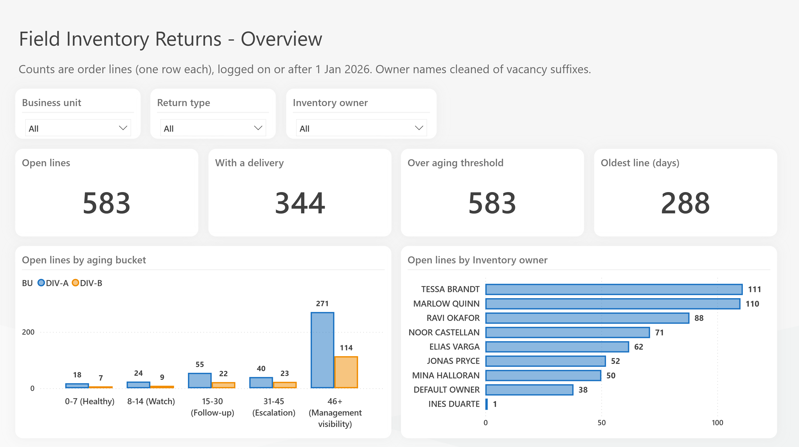
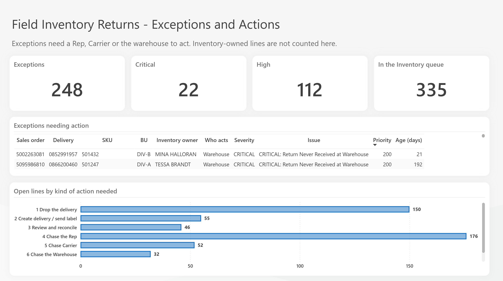
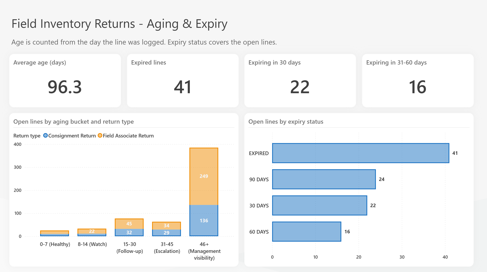

# Field Returns Dashboard — Power BI demo

A seven-page Power BI project (PBIP / TMDL / PBIR) that tracks **open field-return order lines**, works out what has actually happened to each returned unit, and tells the right person what to do next.

**All data in this repository is synthetic.** It is generated by `data_gen/generate_demo_data.py` (seeded and reproducible). Every customer, owner, product, order, document and tracking number is fictional.



## What the model does

For every open return line the model looks across five sources and classifies it:

| Source | What it tells the model |
|---|---|
| Return order lines (`delivery.csv`) | what was ordered, when, for whom, and whether a delivery exists |
| Warehouse movements (`movement.csv`) | whether the return was dispatched (RET) and received at the warehouse (WHR), and how many units |
| Field inventory (`cockpit.csv`) | whether the unit is still sitting in the field, in transit, or gone |
| Carrier tracking (`carrier_status.csv`) | the latest carrier status per tracking number: label created, in transit, delivered |
| Owner alignment (`owner_alignment.csv`) | who owns the line, matched by region, then territory, then account, else a default owner |

From those it derives, per line: a movement status, an inventory status, a recommended action, **who acts next** (Inventory, Rep, Carrier or Warehouse), an action group (1 Drop the delivery … 7 Close the return), a plain-language next step, an exception severity, an age bucket and an expiry status.

Pages: **Overview**, **My Actions** (personal worklist), **Aging & Expiry**, **Exceptions and Actions**, **Inventory Scorecard**, **Return Detail**, **Inventory Performance by Month**.

| Exceptions and Actions | Aging and Expiry |
|---|---|
|  |  |

## Checking the logic

The generator builds each open line from a scenario that is meant to land in one branch of the classification (no delivery on the return order, delivery not dropped, partial or full warehouse receipt, carrier says delivered, unit still in the field, and so on). It writes `data/expected_actions.csv`, the owner and action group each line was designed to get.

After a refresh, the model's output matches it exactly — 583 open in-scope lines:

| Who acts | Action group | Lines |
|---|---|---|
| Inventory | 1 Drop the delivery | 150 |
| Inventory | 2 Create delivery / send label | 55 |
| Inventory | 3 Review and reconcile | 46 |
| Inventory | 4 Chase the Rep | 12 |
| Inventory | 7 Close the return | 72 |
| Rep | 4 Chase the Rep | 164 |
| Carrier | 5 Chase Carrier | 52 |
| Warehouse | 6 Chase the Warehouse | 32 |

Check it yourself in DAX query view:

```dax
EVALUATE
SUMMARIZECOLUMNS (
    Delivery[action_owner], Delivery[action_group],
    FILTER ( ALL ( Delivery[is_in_scope] ), Delivery[is_in_scope] = TRUE () ),
    "lines", COUNTROWS ( Delivery )
)
ORDER BY Delivery[action_owner], Delivery[action_group]
```

## Open it

1. Copy this folder somewhere, for example `C:\ReturnsDemo\`.
2. Open `Returns Dashboard.pbip` in Power BI Desktop. If your data folder is not `C:\ReturnsDemo\data\`, change the **DataFolder** parameter (Transform data → Manage parameters).
3. Refresh.

To regenerate the data: `python data_gen/generate_demo_data.py --out data` (needs `numpy` and `pandas`). Dates are anchored to `--today` (default 2026-10-23), so the same arguments always produce the same files. The report itself ages lines against the real current date, so age figures grow as time passes.

## Notes

- The aging threshold measure is deliberately 1 day, so every open line counts as over threshold. Change the `Aging Threshold Days` measure to see the other buckets and the scorecard react.
- The report uses a third-party theme file (`sqlbi.json`); swap it under *View → Themes* if you prefer another. Power BI's PBIR validator reports warnings for that theme file; Desktop opens and renders the report normally.
